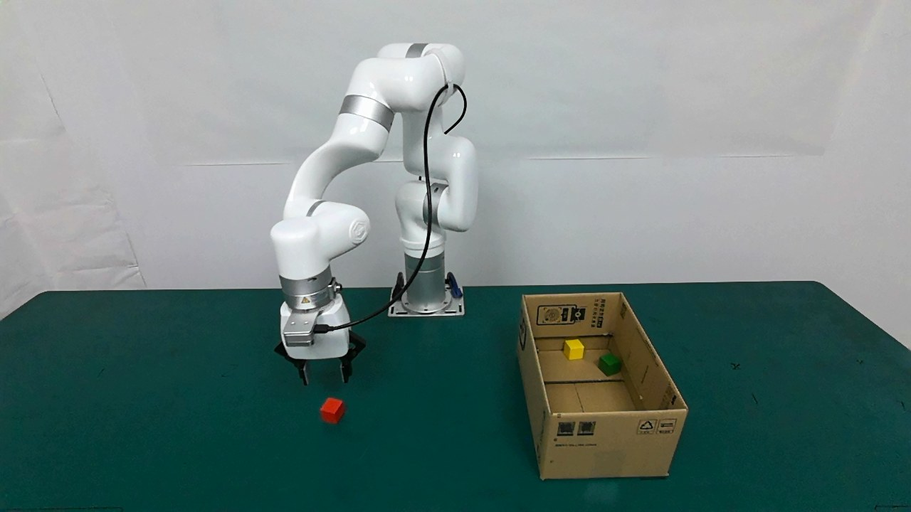
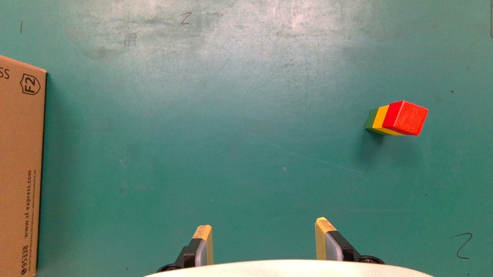
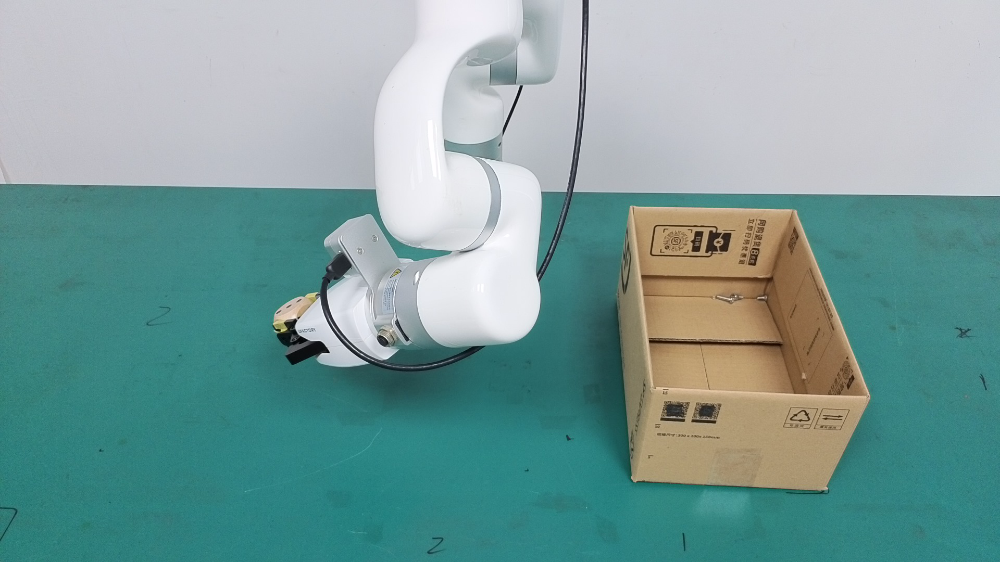
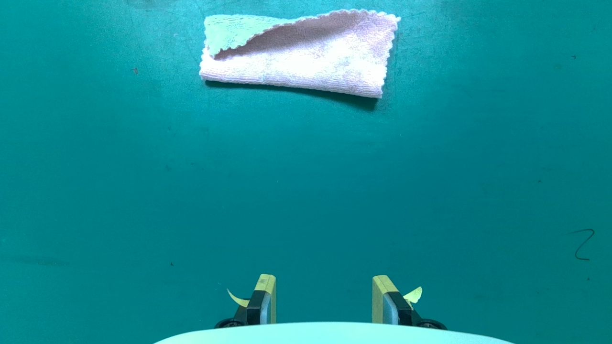

# ufactory_ai_eval

[简体中文](./README_CN.md) | [Online Interactive Report](https://xarm-developer.github.io/ufactory_ai_eval/)

## Project Overview

`ufactory_ai_eval` is a physical robotic manipulation benchmark project built on **UFACTORY xArm6**. Modeled after the [Artificial Analysis AA-Robotics v0.1](https://artificialanalysis.ai/articles/aa-robotics) evaluation methodology, it systematically evaluates and compares **GPT-6 Astra**, **Gemini 4 Argon**, and **Claude Fable 5.2** on an identical physical workcell across four tabletop manipulation tasks, covering task scores, execution time, API token cost, activity time breakdown, and dual-camera telemetry.

## Hardware Configuration

| Component | Specification |
| :--- | :--- |
| Robot Arm | UFACTORY xArm6 (6-DoF collaborative robot arm) |
| End Effector | UFACTORY Parallel Gripper |
| Wrist Camera (Eye-in-Hand) | Intel RealSense D405 close-range RGB-D camera |
| Scene Camera (Overhead) | Intel RealSense D555 / Insta360 Link 2C |
| Control Mode | Autonomous closed-loop visual servoing and motion scripts authored by each model |

## Benchmark Tasks

| Red Cube Pick & Place | 3-Cube Precision Stacking | Die Flipping (Top -2) | Deformable Towel Folding |
| :---: | :---: | :---: | :---: |
|  |  |  |  |

## Evaluation Results

| Task | GPT-6 Astra | Gemini 4 Argon | Claude Fable 5.2 |
| :--- | :---: | :---: | :---: |
| Red Cube Pick & Place | **100.0** (20/20) | **100.0** (20/20) | — |
| 3-Cube Precision Stacking | **100.0** (2/2) | **75.0** (4 runs) | — |
| Die Flipping (Reduce Top by 2) | **100.0** (4/4) | **25.0** (1/4) | **100.0** (3/3) |
| Deformable Towel Folding | **50.0** (1/2) | **50.0** (1/2) | **75.0** (3/4) |
| **AA-Robotics Mean Score** | **87.5** | **62.5** | **87.5\*** |

> **Note:** Claude Fable 5.2 mean score is averaged across its 2 evaluated tasks (Die Flipping and Deformable Towel Folding). GPT-6 Astra and Gemini 4 Argon are averaged across all 4 tasks.

