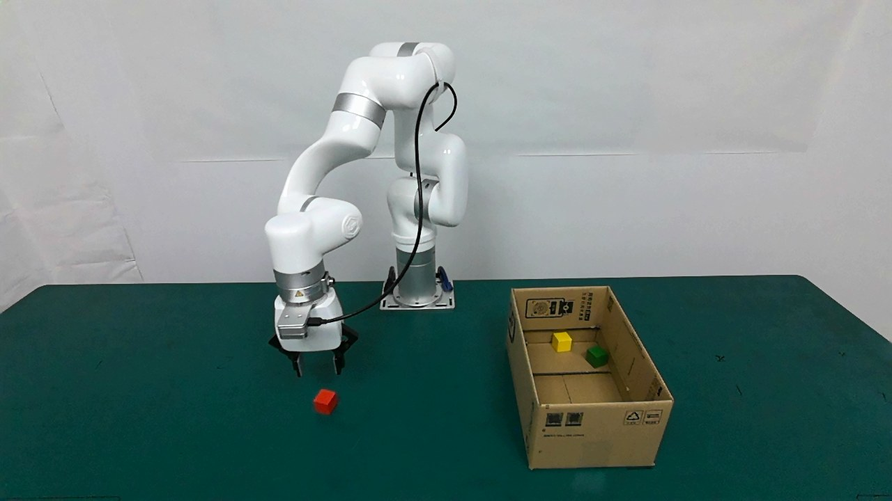
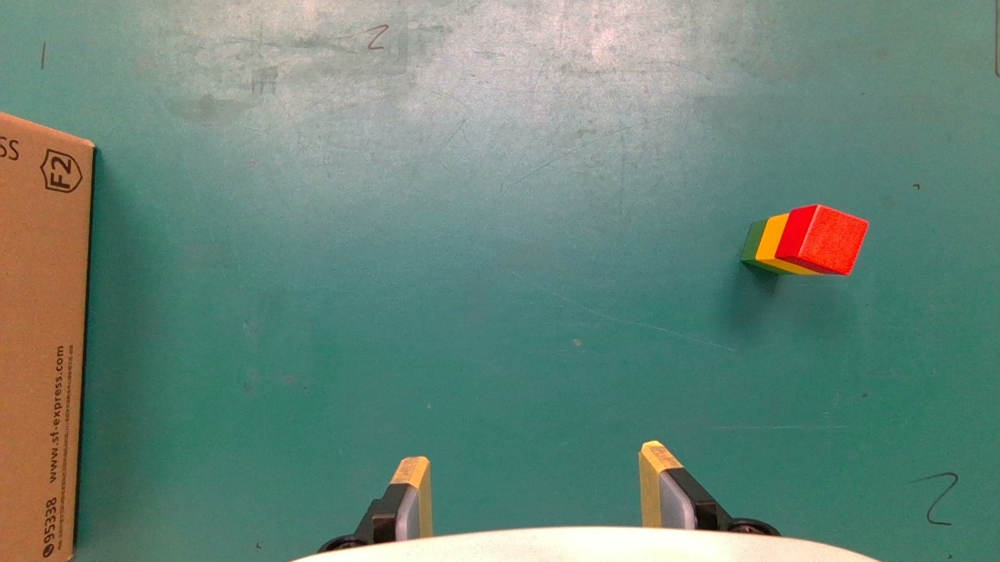
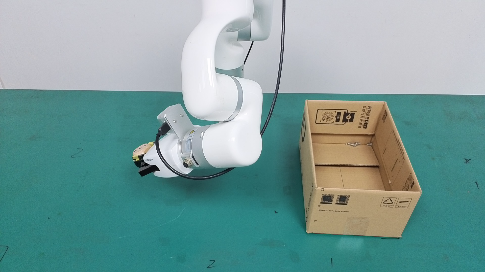
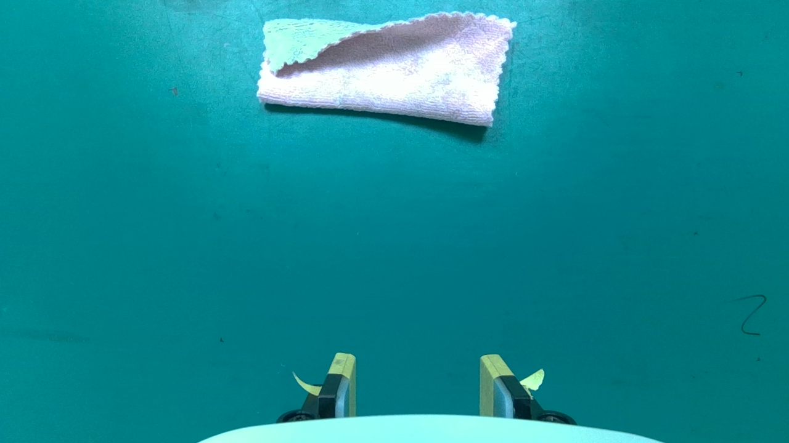

# ufactory_ai_eval

[English](./README.md) | [在线交互评测报告](https://xarm-developer.github.io/ufactory_ai_eval/)

## 项目概述

`ufactory_ai_eval` 是基于 **UFACTORY xArm6** 协作机械臂构建的具身智能真机物理操作评测项目。参照 [Artificial Analysis AA-Robotics v0.1](https://artificialanalysis.ai/articles/aa-robotics) 评测基准，在同一套真实物理工作站上系统评测并对比了 **GPT-6 Astra**、**Gemini 4 Argon** 与 **Claude Fable 5.2** 在四大桌面物理操作任务上的得分、有效耗时、Token 成本、活动时间分配与双机位遥测数据。

## 硬件配置

| 模块 | 硬件规格 |
| :--- | :--- |
| 协作机械臂 | UFACTORY xArm6（6 自由度协作机械臂） |
| 末端执行器 | UFACTORY 平行夹爪 |
| 腕部相机 (Eye-in-Hand) | Intel RealSense D405 近距 RGB-D 深度相机 |
| 全局相机 (Overhead) | Intel RealSense D555 / Insta360 Link 2C |
| 控制方式 | 模型自主编写并迭代视觉伺服与运动控制脚本，真机闭环执行 |

## 评测任务预览

| 红木块入盒 | 三方块叠放 | 桌面翻筛子（顶面减 2） | 桌面叠毛巾 |
| :---: | :---: | :---: | :---: |
|  |  |  |  |

## 评测结果总览

| 评测任务 | GPT-6 Astra | Gemini 4 Argon | Claude Fable 5.2 |
| :--- | :---: | :---: | :---: |
| 红木块入盒 | **100.0** (20/20) | **100.0** (20/20) | — |
| 三方块叠放 | **100.0** (2/2) | **75.0** (共 4 次) | — |
| 桌面翻筛子（朝上点数减 2） | **100.0** (4/4) | **25.0** (1/4) | **100.0** (3/3) |
| 桌面叠毛巾 | **50.0** (1/2) | **50.0** (1/2) | **75.0** (3/4) |
| **AA-Robotics 综合均分** | **87.5** | **62.5** | **87.5\*** |

> **注：** Claude Fable 5.2 综合均分基于其参与评测的 2 项任务（桌面翻筛子、桌面叠毛巾）计算；GPT-6 Astra 与 Gemini 4 Argon 基于全部 4 项任务计算。

